<div align="center">

# 🧠 TinyReasoner

**A small language model built completely from scratch, taught to solve maths step by step,<br/>
then made better with reinforcement learning (GRPO, the method behind DeepSeek-R1).**

Tokenizer · Transformer · SFT · GRPO · LoRA · int8 quantization · Speculative decoding · Streaming API<br/>
*Every part is hand-written in PyTorch. No pretrained weights, no downloaded dataset, no GPU.*

[](https://github.com/RishitheB0T/tiny-reasoner/actions/workflows/ci.yml)


[](LICENSE)

[Highlights](#-highlights) · [Results](#-results) · [How it works](#-how-it-works) · [Build steps](#-the-build-step-by-step) · [Quick start](#-quick-start) · [API](#-api)

</div>

<p align="center">
  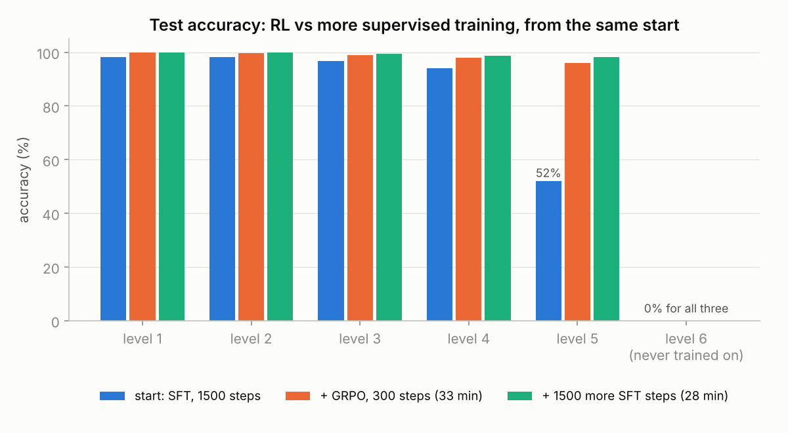
</p>

---

## ✨ Highlights

| | Area | Result |
|:-:|---|---|
| 🧠 | **Model** | 4.3M-parameter Llama-style transformer, trained from random weights on a 4-core CPU |
| 🎓 | **Stage 1: SFT** | 3,000 steps in 59 min → **100 / 100 / 99.3 / 98.7 / 98.3 %** on difficulty levels 1–5 |
| 🏋️ | **Stage 2: GRPO** | Hardest level **52 % → 96 %** in 33 min, learning only from *right / wrong* feedback |
| ⚖️ | **RL vs more SFT** | From the same start, 28 more minutes of SFT reached **98.3 %**: with perfect demonstrations, SFT is slightly more efficient |
| 🧩 | **LoRA** | New skill (long division) **0 % → 99.7 %** training 5 % of the weights; replay keeps old skills at **99.2 %** |
| ⚡ | **KV cache** | **3.0×** faster at batch 1, **16.3×** faster at batch 32 |
| 🗜️ | **int8 quantization** | **3.7×** smaller with the same accuracy |
| 🎯 | **Speculative decoding** | Up to **1.87×** faster, with identical output on 60 / 60 prompts |
| 🌐 | **Serving** | FastAPI app with token streaming (Server-Sent Events) and a demo page |
| 🧪 | **Engineering** | 41 unit tests, Docker image, GitHub Actions CI, metrics logged for every run |

---

## 💡 The idea in 30 seconds

1. **Write practice questions with code.** Because code wrote them, the right answer is always known.
2. **School (SFT).** The model copies thousands of worked solutions and learns to write its working before the answer.
3. **Practice (GRPO).** The model answers each question 8 times. Code checks which answers are right, and the model is nudged towards the answers that beat their group's average. Nobody tells it *how*, only *whether* it was right.
4. **Extras.** Teach it a brand-new skill cheaply (LoRA), make it smaller and faster (quantization, KV cache, speculative decoding), and serve it as a streaming web app.

> **Memory hook:** *Questions → Words → Brain → School → Practice → New skill → Speed → Shop*<br/>
> (data → tokenizer → model → SFT → GRPO → LoRA → speed-ups → API)

---

## 🔢 What the model learns to write

Every problem is a **prompt** plus a **worked completion**. The model writes the solution right-to-left, like school maths, one column per step:

```text
Q:347+586
A:347+586:7+6+0=13|4+8+1=13|3+5+1=9|=933;<answer>933</answer>
```

| Column | Step the model writes | What it means |
|---|---|---|
| units | `7+6+0=13` | 7 + 6 + carry 0 = 13 → write **3**, carry 1 |
| tens | `4+8+1=13` | 4 + 8 + carry 1 = 13 → write **3**, carry 1 |
| hundreds | `3+5+1=9` | 3 + 5 + carry 1 = 9 → write **9** |
| result | `=933;<answer>933</answer>` | the result, then the final answer in tags so code can grade it |

All six problem kinds, exactly as the generator writes them:

```text
add    347+586   →  347+586:7+6+0=13|4+8+1=13|3+5+1=9|=933;<answer>933</answer>
sub    905-387   →  905-387:5-7-0=8b1|0-8-1=1b1|9-3-1=5b0|=518;<answer>518</answer>
mul1   347*6     →  347*6:7*6+0=42|4*6+4=28|3*6+2=20|=2082;<answer>2082</answer>
mul2   47*36     →  47*6:7*6+0=42|4*6+4=28|=282;47*3:7*3+0=21|4*3+2=14|=141;282+1410:2+0+0=2|8+1+0=9|2+4+0=6|0+1+0=1|=1692;<answer>1692</answer>
expr   52+34-17  →  52+34:2+4+0=6|5+3+0=8|=86;86-17:6-7-0=9b1|8-1-1=6b0|=69;<answer>69</answer>
div    947/4     →  947/4:9/4=2r1|14/4=3r2|27/4=6r3|=236r3;<answer>236r3</answer>
```

<sub>`b1` = borrow 1 · `r3` = remainder 3 · `;` ends one sub-calculation · long division (`div`) is never in the main training data: it is the new skill taught with LoRA.</sub>

### Difficulty levels

| Level | Problems | Seen in training? |
|:-:|---|---|
| 1 | 2-digit add / subtract, 2-digit × 1-digit | ✅ yes |
| 2 | 3-digit add / subtract, 3-digit × 1-digit | ✅ yes |
| 3 | 4-digit add / subtract, 4-digit × 1-digit, 3-number expressions like `a+b-c` (2-digit numbers) | ✅ yes |
| 4 | 5-digit add / subtract, 2-digit × 2-digit, 4-number expressions like `a+b-c+d` (2-digit numbers) | ✅ yes |
| 5 | 6-digit add / subtract, 3-digit × 2-digit, 4-number expressions (3-digit numbers) | ⚠️ only 3 % of the training data |
| 6 | 7-digit add / subtract, 4-digit × 2-digit, 5-number expressions like `a+b-c+d-e` (3-digit numbers) | ❌ never: tests *length generalization* |

**Datasets:** 200,000 training problems · 2,000 validation · 20,000 RL prompts (levels 3–6) · 300 held-out test problems per level · 30,000 + 300 long-division problems.
Test questions are generated first and banned from every training set, so nothing leaks. The generator is deterministic: regenerating the data reproduces every file byte for byte.

---

## 📊 Results

> Every number below comes from this repo's own runs on a 4-core CPU. The raw metrics are in [`results/`](results) (evaluations, benchmarks, pass@k, LoRA) and [`runs/`](runs) (per-step training logs).

### RL vs more supervised training, from the same starting point

All three models start from the **same half-trained model** (SFT step 1,500). Held-out test sets, 300 problems per level, greedy decoding.

| Model | L1 | L2 | L3 | L4 | L5 | L6 *(never trained on)* | Time |
|---|:-:|:-:|:-:|:-:|:-:|:-:|:-:|
| Start: SFT, 1,500 steps | 98.3 % | 98.3 % | 96.7 % | 94.0 % | 52.0 % | 0.0 % | 31 min |
| Start + **300 GRPO steps** | 100 % | 99.7 % | 99.0 % | 98.0 % | **96.0 %** | 0.0 % | + 33 min |
| Start + **1,500 more SFT steps** | 100 % | 100 % | 99.3 % | 98.7 % | **98.3 %** | 0.0 % | + 28 min |

### Key findings

1. 🎯 **RL works from a single bit of feedback.** GRPO never saw a worked solution for the problems it practised on, only "right" or "wrong", yet it took level 5 from 52 % to 96 %. It also improved levels 1–3, which it never practised.
2. 📚 **When perfect demonstrations are cheap, SFT is more efficient.** SFT learns from every token of a correct solution; RL gets about one bit per attempt. RL earns its keep when answers can be *checked* but perfect solutions can't be *written*, which is the situation for frontier maths and code models.
3. 🔁 **RL amplifies; it doesn't create.** On level 5, the RL model's *first* try (97 %) beat the starting model's *best of 8* (67 %). But on level 6, where the model never succeeded even once in 8 tries, every group had zero advantage and RL changed nothing.
4. 📏 **Length generalization is hard for transformers.** Trained only on numbers of up to 6 digits, the model can't even *copy* a 7-digit number: `8444574-1207911` became `84449-120791`.

### pass@k: sharpening old skills, or learning new ones?

**pass@1** = the first (greedy) answer is right · **pass@8** = at least one of 8 samples (temperature 1) is right · 100 test problems per level.

| Model | L4 pass@1 | L4 pass@8 | L5 pass@1 | L5 pass@8 | L6 pass@1 | L6 pass@8 |
|---|:-:|:-:|:-:|:-:|:-:|:-:|
| Start: SFT, 1,500 steps | 93 % | 98 % | 52 % | 67 % | 0 % | 0 % |
| Start + GRPO | 99 % | 99 % | **97 %** | 99 % | 0 % | 0 % |
| Start + more SFT | 100 % | 100 % | 100 % | 100 % | 0 % | 0 % |

### Stage 1: supervised fine-tuning

Training loss fell from 5.68 to about 0.0003. Average validation accuracy: **57 %** at step 500 → **80 %** at 1,000 → **96 %** at 1,500 → **98 %** at 3,000.

<p align="center">
  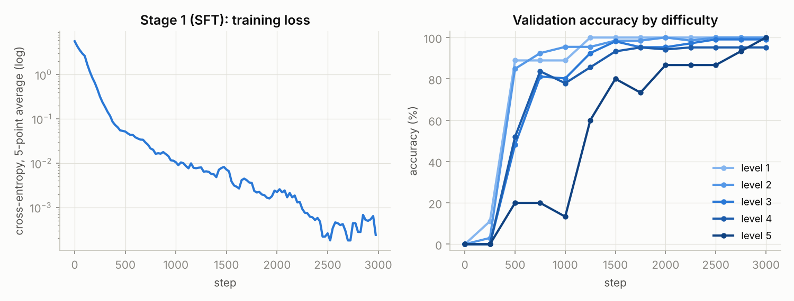
</p>

### Stage 2: reinforcement learning with GRPO

<p align="center">
  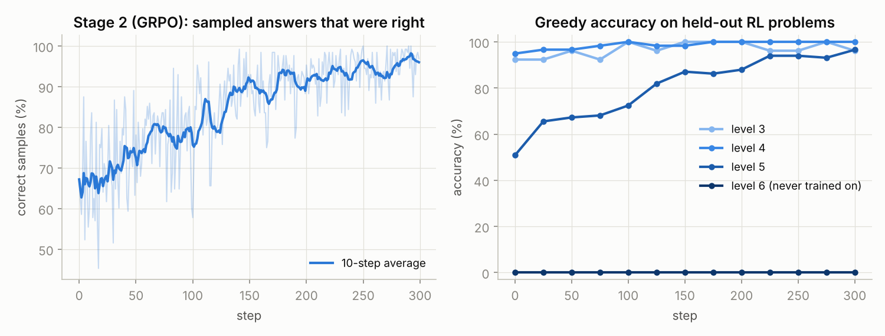
</p>

<table>
<tr>
<td width="55%" valign="top">

| GRPO steps | Correct samples | Groups with no signal *(all 8 tied)* | KL from start model |
|---|:-:|:-:|:-:|
| 0–24 | 67 % | 67 % | 0.012 |
| 100–124 | 82 % | 74 % | 0.019 |
| 275–299 | 97 % | 88 % | 0.024 |

As the model gets better, more groups are all-correct and teach nothing, so learning slows down near the top (methods like DAPO resample those groups).

The KL spike at step 0 comes from Adam's very first, bias-corrected update, which moves every weight by about the full learning rate. It settles within one step.

</td>
<td width="45%" valign="top">
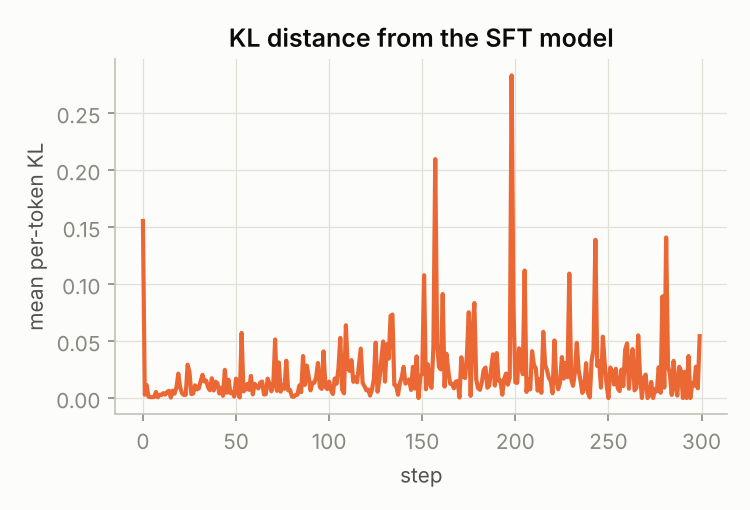
</td>
</tr>
</table>

### LoRA: teaching a brand-new skill (long division)

<p align="center">
  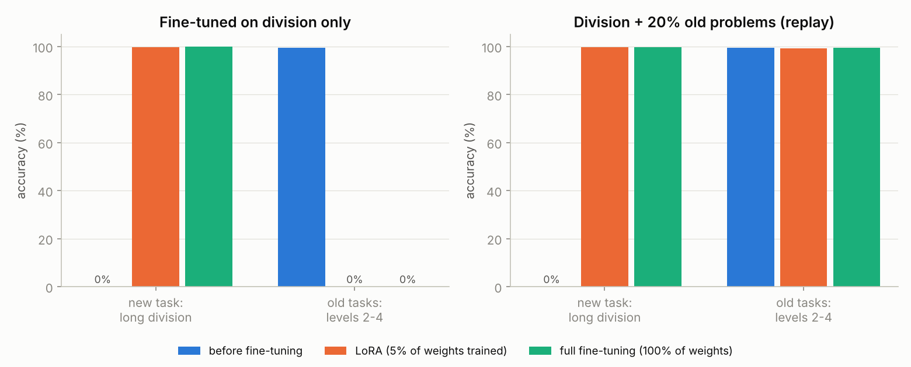
</p>

| Method | Weights trained | Division only: new / old skills | With 20 % replay: new / old skills | Saved file |
|---|---|:-:|:-:|---|
| Before fine-tuning | – | 0.0 % / 99.5 % | 0.0 % / 99.5 % | – |
| **LoRA** (rank 8) | 218,624 (5.1 %) | 99.7 % / **0.0 %** | 99.7 % / **99.2 %** | **0.86 MB** adapter |
| Full fine-tuning | 4,298,240 (100 %) | 100 % / **0.0 %** | 99.7 % / **99.5 %** | 16.4 MB model |

<sub>"new" = long division · "old" = levels 2–4 · 600 steps each, starting from the final SFT model.</sub>

Trained on division alone, **both methods forgot the old skills completely** (*catastrophic forgetting*). The model even started writing division steps inside subtraction problems:

```text
Q:326-247  →  326-247:6-7-0=0rr|2/2=8r0|6/2=3r0|=383;<answer>38r3</answer>
```

Mixing 20 % old problems into every batch ("replay") fixed levels 2–4. Re-checking **every** level then exposed a hidden loss on the hardest one:

| Model | L1 | L2 | L3 | L4 | L5 |
|---|:-:|:-:|:-:|:-:|:-:|
| Before (SFT, 3,000 steps) | 100 % | 100 % | 99.3 % | 98.7 % | **98.3 %** |
| LoRA + replay (merged) | 100 % | 100 % | 98.7 % | 98.3 % | **85.3 %** |
| Full fine-tuning + replay | 100 % | 100 % | 99.3 % | 98.7 % | **93.7 %** |

**Lessons:** LoRA matched full fine-tuning on the new task with 5 % of the trainable weights and a 19× smaller file. LoRA alone does **not** prevent forgetting; replay does. Always re-test *every* old skill. Merging B·A into W changed nothing (99.7 % / 99.2 % before and after), exactly as the maths says. Because of the level-5 drop, the web app serves the plain SFT model.

### Speed and size

<p align="center">
  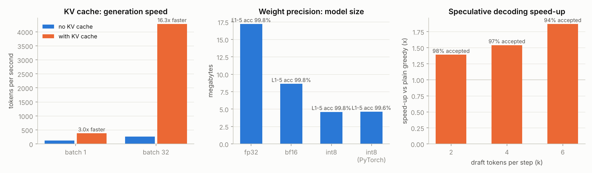
</p>

<table>
<tr>
<td valign="top">

**KV cache** *(120 new tokens after a level-6 prompt)*

| Batch | No cache | With cache | Speed-up |
|:-:|:-:|:-:|:-:|
| 1 | 125.8 tok/s | 378.5 tok/s | **3.01×** |
| 32 | 263.0 tok/s | 4,278.6 tok/s | **16.27×** |

</td>
<td valign="top">

**Weight precision** *(100 test problems per level)*

| Variant | Size | Acc. L1–5 | Speed |
|---|:-:|:-:|:-:|
| float32 | 17.2 MB | 99.8 % | 381.1 tok/s |
| bfloat16 | 8.6 MB | 99.8 % | 274.2 tok/s |
| int8 (ours) | **4.6 MB** | 99.8 % | 253.5 tok/s |
| int8 (PyTorch) | 4.6 MB | 99.6 % | 292.7 tok/s |

</td>
</tr>
</table>

**Speculative decoding** *(target 4.3M parameters, draft 0.4M, 60 prompts one at a time)*

| k *(draft guesses per step)* | Same output as greedy? | Guesses accepted | Tokens per big-model call | Time | Speed-up |
|:-:|:-:|:-:|:-:|:-:|:-:|
| plain greedy | – | – | 1.00 | 11.33 s | 1.00× |
| 2 | ✅ 60 / 60 | 98.2 % | 2.93 | 8.16 s | **1.39×** |
| 4 | ✅ 60 / 60 | 96.8 % | 4.75 | 7.24 s | **1.54×** |
| 6 | ✅ 60 / 60 | 94.1 % | 6.43 | 6.56 s | **1.87×** |

- **The KV cache** matters because, without it, every new token re-processes the whole sequence, so the work grows with the length *squared*; the bigger the batch, the more that waste costs.
- **int8 is 3.7× smaller with no accuracy loss** (average rounding error 0.72 % per weight), but **not faster here**: a 4M-parameter model already fits in the CPU cache, so per-layer overhead dominates, not memory bandwidth. Quantization pays off for big models on GPUs and phones.
- **Speculative decoding** wins because the draft model is cheap *and* almost always right, so each big-model call produces about k + 1 tokens instead of 1.

<details>
<summary><b>Training curves of the 0.4M-parameter draft model</b></summary>
<br/>

A 2-layer × 128-wide model trained with the same SFT code (`make draft`, about 5 minutes). It reaches 97 % accuracy on its own, which is why the big model accepts almost all of its guesses.

<p align="center">
  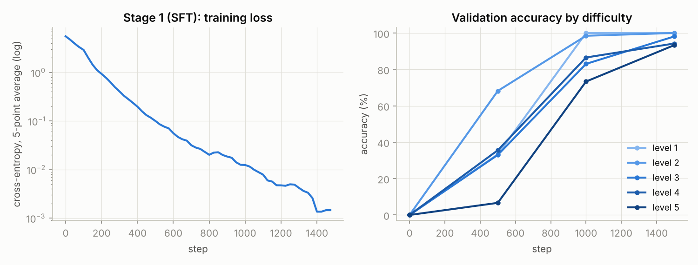
</p>

</details>

---

## 🧩 How it works

### The pipeline

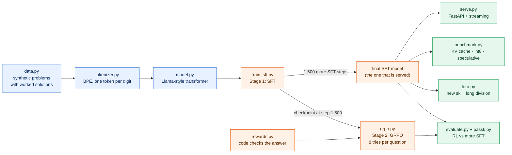

### 1 · The tokenizer: text → numbers

Byte Pair Encoding (BPE) written from scratch: start from the 256 bytes, then repeatedly glue the most common neighbouring pair into a new token. Before BPE, a regex cuts the text into chunks, and **every digit is its own chunk**, so `347` is always the three tokens `3`, `4`, `7`, and the model can line up columns. (GPT-4 allows up to 3 digits per token, one reason LLMs are clumsy at arithmetic.)

```text
"347"        →  [51, 52, 55]                     one token per digit
"<answer>"   →  "<"  "answer"  ">"               8 bytes merged into 3 tokens
vocabulary   =  256 bytes + 8 merges + <|endoftext|>  =  265 tokens
```

### 2 · The model: a Llama-style transformer

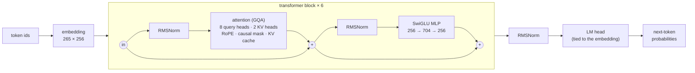

<table>
<tr>
<td valign="top">

| Setting | Value |
|---|---|
| Layers | 6 |
| Width | 256 |
| Heads | 8 query · 2 key/value |
| Head size | 32 |
| MLP hidden size | 704 |
| Context | 256 tokens |
| Vocabulary | 265 tokens |
| **Parameters** | **4,298,240** |

</td>
<td valign="top">

| Upgrade over GPT-2 | In plain words |
|---|---|
| **RoPE** | Position is shown by *rotating* query and key vectors, so attention depends on the *distance* between tokens |
| **RMSNorm** | Only rescales the numbers (no mean, no bias) |
| **SwiGLU** | An MLP with a gate: `w2(silu(w1 x) * w3 x)` |
| **GQA** | 8 query heads share 2 key/value heads, so the KV cache is 4× smaller |
| **KV cache** | Remember past keys and values; each new token needs one small pass |

</td>
</tr>
</table>

### 3 · Stage 1: supervised fine-tuning (SFT)

The model is trained to predict the worked solution token by token, but it is **graded only on the answer part**: the prompt's targets are set to `-100`, which PyTorch's loss ignores.

```text
Q:347+586\nA:     347+586:7+6+0=13|4+8+1=13|3+5+1=9|=933;<answer>933</answer><|endoftext|>
└─ prompt ──┘     └───────────────────────────── completion ─────────────────────────────┘
targets = -100    the loss is computed on these tokens only
```

**Recipe:** AdamW · learning rate 1e-3 with 100 warm-up steps then cosine decay · gradient clipping at 1.0 · batch 64 · 3,000 steps.

### 4 · Stage 2: GRPO, reinforcement learning with verifiable rewards

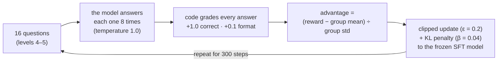

**One group, worked through.** 8 tries at the same question, 3 of them right (the wrong ones are still well formatted):

| Try | 1 | 2 | 3 | 4 | 5 | 6 | 7 | 8 |
|---|:-:|:-:|:-:|:-:|:-:|:-:|:-:|:-:|
| Result | ✅ | ❌ | ✅ | ❌ | ❌ | ✅ | ❌ | ❌ |
| Reward | 1.1 | 0.1 | 1.1 | 0.1 | 0.1 | 1.1 | 0.1 | 0.1 |
| Advantage | **+1.21** | −0.72 | **+1.21** | −0.72 | −0.72 | **+1.21** | −0.72 | −0.72 |

Right answers become more likely and wrong ones less likely. If all 8 answers score the same, every advantage is 0 and the group teaches nothing, so RL needs problems the model solves *sometimes*.

$$
A_i = \frac{r_i - \operatorname{mean}(r_1, \dots, r_8)}{\operatorname{std}(r_1, \dots, r_8)}
$$

$$
\mathcal{L} = -\frac{1}{|o|} \sum_t \Big[ \min\big( \rho_t A,\ \operatorname{clip}(\rho_t,\ 1-\varepsilon,\ 1+\varepsilon)\, A \big) - \beta\, \mathrm{KL}_t \Big]
$$

$$
\rho_t = \frac{\pi_\theta(o_t)}{\pi_{\text{old}}(o_t)}, \qquad \mathrm{KL}_t = e^{d_t} - d_t - 1, \qquad d_t = \log \pi_{\text{ref}}(o_t) - \log \pi_\theta(o_t)
$$

<sub>The loss is averaged over each answer's tokens, then over answers. The KL term uses the "k3" estimator, which is always ≥ 0 and is 0 only when the two models agree.</sub>

- **Rewards are checked by code**, with no human labels and no learned reward model. The format reward (0.1) is deliberately small, so a well-formatted *wrong* answer can never beat a right one (no reward hacking).
- **Clipping** stops any answer's probability moving more than ±20 % per update, because each batch of samples is reused for 2 passes.
- **The KL penalty** keeps the model close to a frozen copy of the SFT model, so it can't drift into nonsense.
- **Why not PPO?** PPO needs a second "critic" network to estimate the baseline. GRPO uses the group's average instead, which is simpler and uses half the memory.

### 5 · LoRA: a new skill for 5 % of the weights

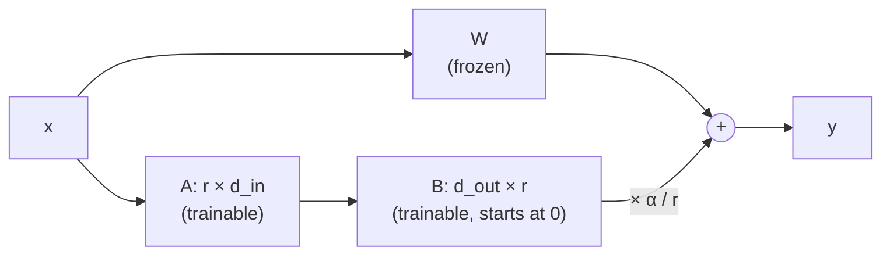

$$
W' = W + \frac{\alpha}{r}\, B A, \qquad r = 8,\ \ \alpha = 16
$$

LoRA is applied to every linear layer in all 6 blocks. Because `B` starts at zero, training begins exactly at the original model, and after training `B·A` is merged into `W`, so inference costs nothing extra. Division uses two characters the model had never seen (`/` and `r`), whose embedding rows were still random. So exactly those 2 rows are trained as well, through a gradient mask (the same idea as PEFT's `modules_to_save`).

### 6 · Speed-ups

**Speculative decoding:** a tiny model guesses, the big model checks.

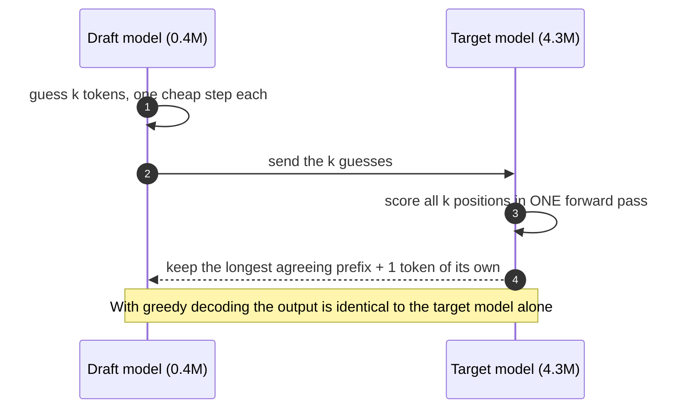

**int8 quantization:** each weight row gets one scale, and weights are stored as 8-bit integers (de-quantized on the fly).

$$
s_{\text{row}} = \frac{\max |w_{\text{row}}|}{127}, \qquad w_{\text{int8}} = \operatorname{round}\left(\frac{w}{s_{\text{row}}}\right)
$$

---

## 🪜 The build, step by step

The project was built in 13 steps, and **each step is its own commit**. Click a commit to see exactly what was added.

| # | Step | What was built | Key result | Commit |
|:-:|---|---|---|:-:|
| 1 | 📦 Project setup | packaging, dependencies, ignore rules | – | [`a7c7f5f`](https://github.com/RishitheB0T/tiny-reasoner/commit/a7c7f5f9fcbf863e6e24bb6fcd83b474fd9f528d) |
| 2 | 📝 Practice problems | generator for levels 1–6 + long division, with worked solutions | 200k training problems | [`e799cdd`](https://github.com/RishitheB0T/tiny-reasoner/commit/e799cdd860e4d10a6f0e110fe86d2ca57b8ca6d0) |
| 3 | 🔤 Tokenizer | byte-level BPE, one token per digit | 265-token vocabulary | [`758ec32`](https://github.com/RishitheB0T/tiny-reasoner/commit/758ec3231cab2e5cc0fb0beadeeb59b903ecd4ff) |
| 4 | 🧠 Transformer | RoPE, RMSNorm, SwiGLU, GQA, KV cache | 4.30M parameters | [`d27cf15`](https://github.com/RishitheB0T/tiny-reasoner/commit/d27cf15cf7d1ddf77e5263f387f919a297f22a42) |
| 5 | 🎓 SFT | answer-only loss, AdamW + cosine schedule | 3,000 steps in 59 min | [`8a38450`](https://github.com/RishitheB0T/tiny-reasoner/commit/8a384505017f85f09b1b58339a79359d71c4593c) |
| 6 | 📏 Evaluation | greedy accuracy per level on held-out tests | 98–100 % on L1–5, 0 % on L6 | [`1396c64`](https://github.com/RishitheB0T/tiny-reasoner/commit/1396c6465cae5e09a733f1ded4852efd23e75bea) |
| 7 | 🏋️ GRPO | verifiable rewards, group advantages, clipping + KL | L5: 52 % → 96 % | [`8b3a1cb`](https://github.com/RishitheB0T/tiny-reasoner/commit/8b3a1cb062fd17265d7059678bc65683e0713afd) |
| 8 | 🔁 pass@k | pass@1 vs pass@8, before and after RL | first try 97 % > best-of-8 67 % | [`e190cf5`](https://github.com/RishitheB0T/tiny-reasoner/commit/e190cf593858713a280b7d676a65111e5a13fa3a) |
| 9 | 🧩 LoRA | long division with 5 % of the weights, replay | 0 % → 99.7 % | [`9b0d905`](https://github.com/RishitheB0T/tiny-reasoner/commit/9b0d9059118bd6990186d75561dcaf607d02af1b) |
| 10 | ⚡ Speed-ups | int8, speculative decoding, benchmarks | KV cache up to 16.3× | [`24f76d6`](https://github.com/RishitheB0T/tiny-reasoner/commit/24f76d601705303777bad513b1a8915d7418ff3f) |
| 11 | 🌐 Web app | FastAPI, token streaming, demo page | 61 tokens in 196 ms | [`bb536ce`](https://github.com/RishitheB0T/tiny-reasoner/commit/bb536ceb154861a9c143cfcbd723739ea388ccc2) |
| 12 | 🛠️ Tooling | Makefile, Dockerfile, CI workflow | 41 tests on every push | [`74df1a5`](https://github.com/RishitheB0T/tiny-reasoner/commit/74df1a5d3a088457f99448a63460c0e13147cd92) |
| 13 | 📈 Plots & report | every figure drawn from the logged metrics | 7 figures | [`b877f43`](https://github.com/RishitheB0T/tiny-reasoner/commit/b877f432ccbe0fa1c23bef6c9854921bd6f4b3fa) |

<details>
<summary><b>Step 1 · Project setup</b></summary>
<br/>

- **Files:** `pyproject.toml`, `requirements.txt`, `.gitignore`
- **Command:** `make setup`
- **Tip:** PyTorch from PyPI pulls in about 3 GB of NVIDIA libraries, even on machines without a GPU. `pip install torch --index-url https://download.pytorch.org/whl/cpu` gives a CPU-only build of about 200 MB.

</details>

<details>
<summary><b>Step 2 · Generate the practice problems (synthetic, verifiable data)</b></summary>
<br/>

- **Files:** `src/tinyreasoner/data.py`, `tests/test_data.py`
- **Command:** `make data`
- **Result:** `train=200000 val=2000 rl=20000 div_train=30000 test=1800 div_test=300`
- **Mistakes to avoid:** subtraction must never go negative (always subtract the smaller number; in expressions, flip `-` to `+` when needed). And test the generator: `tests/test_data.py` compares every generated answer with Python's own arithmetic.

</details>

<details>
<summary><b>Step 3 · Build the tokenizer</b></summary>
<br/>

- **Files:** `src/tinyreasoner/tokenizer.py`, `tests/test_tokenizer.py`, `data/tokenizer.json`
- **Command:** `make tokenizer`
- **Result:** only **8 merges** were useful, giving a vocabulary of 265. That is right for this data: its "language" has about 20 symbols, and digits are never merged. A 55-character example becomes 42 tokens.
- **Mistakes we hit:**
  - Training on all examples joined into one string learned a useless `>\n` token that only exists at the joins. **Fix:** train on each example separately.
  - The pure-Python merge loop over a 10 MB string was slow. **Fix:** count each distinct chunk once with its frequency, then merge over the unique chunks. Same result, much faster.

</details>

<details>
<summary><b>Step 4 · Build the transformer (and choose its size)</b></summary>
<br/>

- **Files:** `src/tinyreasoner/model.py`, `src/tinyreasoner/utils.py`, `tests/test_model.py`
- **Choosing the size:** one training step (64 examples × 110 tokens) was timed for a few sizes:

  | Model | Params | float32 | bfloat16 |
  |---|:-:|:-:|:-:|
  | 4 layers × 256 | 2.89M | 528 ms | 511 ms |
  | **6 layers × 256** | **4.30M** | **827 ms** | 791 ms |
  | 8 layers × 256 | 5.71M | 1,051 ms | 994 ms |

  6 layers in plain float32 won: bfloat16 was barely faster on this CPU.
- **Mistakes we hit (the tests now catch them):**
  - `scaled_dot_product_attention(..., is_causal=True)` assumes queries and keys start at the same position. With a KV cache they don't (one new query, many old keys). **Fix:** an explicit mask whenever there's a cache or padding.
  - **Left padding** made the attention-mask rows of pad tokens completely empty, and softmax over nothing gives `NaN`. **Fix:** every token may always attend to itself.
  - With left padding, positions must start at 0 *after* the padding (a cumulative sum of the mask), or RoPE gives padded prompts different positions.

</details>

<details>
<summary><b>Step 5 · Stage 1 training: SFT</b></summary>
<br/>

- **Files:** `src/tinyreasoner/train_sft.py`, `src/tinyreasoner/evaluate.py`, `configs/sft.json`, `runs/sft/`
- **Command:** `make sft`
- **Result:** 3,000 steps in **59 minutes** (about 1.1 s per step). The step-1,500 checkpoint is kept, because the RL experiment starts from it.
- **Mistakes the model made at step 1,000** (both faded with more training):
  - *Copying single-digit results:* it worked out `35-27` → `=8` correctly, then wrote `<answer>3</answer>`. Single-digit answers are rare in the data.
  - *Times-table slips with a carry,* for example `5*8+6=41` (should be 46).
- **Mistake we hit in a test:** a unit test assumed an untrained model's loss is ln(vocabulary). With tied embeddings a random model slightly prefers repeating its input, so the loss came out lower. **Fix:** use random targets in that test.

</details>

<details>
<summary><b>Step 6 · Measure accuracy properly</b></summary>
<br/>

- **Files:** `results/eval_sft.json`, `results/eval_sft_step1500.json` (+ sample outputs)
- **Command:** `make eval`
- **Why:** a falling loss doesn't prove the model can solve problems, so it *writes* answers with greedy decoding and code checks the `<answer>`. Prompts of similar length are batched together (left-padded) to make this fast.
- **Result:** SFT step 1,500: 98.3 / 98.3 / 96.7 / 94.0 / 52.0 / 0.0 %. SFT step 3,000: 100 / 100 / 99.3 / 98.7 / 98.3 / 0.0 %.
- **Why level 6 is 0 %:** the model can't even copy a 7-digit number it has never seen, and for 4-digit × 2-digit problems it writes `<answer>` too early, because it had never seen that many steps. A classic length-generalization failure.

</details>

<details>
<summary><b>Step 7 · Stage 2 training: GRPO</b></summary>
<br/>

- **Files:** `src/tinyreasoner/rewards.py`, `src/tinyreasoner/grpo.py`, `configs/grpo.json`, `runs/grpo/`, `results/eval_grpo.json`
- **Command:** `make grpo`
- **A fair experiment:** the fully trained SFT model was already at 98–100 % on levels 1–5, leaving RL nothing to learn, and level 6 gave zero signal. So the question became: *from the same half-trained model, what helps more in about half an hour: 300 GRPO steps or 1,500 more SFT steps?*
- **Settings:** levels 4–5 only · 16 questions × 8 answers per step · learning rate 3e-5 · KL β = 0.04 · clip ε = 0.2 · 2 passes per batch · 300 steps.
- **Result:** level 5 went from **52 % to 96 %** in 33 minutes; see [Results](#-results).
- **Checked before trusting it:** `test_grpo_loss_direction` (one update really makes a rewarded answer more likely), `test_group_advantages`, and `test_rewards` (well-formatted wrong answers can't beat right ones).

</details>

<details>
<summary><b>Step 8 · Did RL teach new skills, or sharpen old ones? (pass@k)</b></summary>
<br/>

- **Files:** `src/tinyreasoner/passk.py`, `results/passk.json`, `runs/passk.log`
- **Command:** `make passk`
- **Result:** on level 5, the GRPO model's first try (97 %) beats the starting model's best of 8 (67 %), so RL did more than re-rank answers it could already find. On level 6, pass@8 was 0 % before and after: RL can only strengthen behaviour the model produces at least occasionally.

</details>

<details>
<summary><b>Step 9 · Teach a new skill cheaply: LoRA</b></summary>
<br/>

- **Files:** `src/tinyreasoner/lora.py`, `configs/lora.json`, `configs/lora_replay.json`, `runs/lora/`, `runs/lora_replay/`, `results/lora*.json`
- **Command:** `make lora` (runs both experiments, then re-evaluates every level)
- **Result:** long division 0 % → 99.7 % with 218,624 trainable weights (5.1 %); catastrophic forgetting without replay; old skills kept at 99.2 % with 20 % replay.
- **Mistake we hit:** the new characters `/` and `r` had random embedding rows, and LoRA alone can't fix an input the model can't "see". **Fix:** train those 2 embedding rows too, and only those.

</details>

<details>
<summary><b>Step 10 · Make it fast</b></summary>
<br/>

- **Files:** `src/tinyreasoner/quantize.py`, `src/tinyreasoner/speculative.py`, `src/tinyreasoner/benchmark.py`, `configs/draft.json`, `runs/draft/`, `results/benchmarks.json`, `tests/test_rl_lora_quant.py`
- **Commands:** `make draft` (train the 0.4M draft model), then `make bench`
- **Result:** KV cache 3.0× / 16.3× faster · int8 3.7× smaller at the same accuracy (but not faster on a CPU) · speculative decoding up to 1.87× faster with identical outputs.

</details>

<details>
<summary><b>Step 11 · Turn it into an app</b></summary>
<br/>

- **Files:** `src/tinyreasoner/serve.py`, `tests/test_api.py`
- **Command:** `make serve`, then open <http://localhost:8000>
- **Safety:** questions must match a strict pattern, and the true answer is computed by parsing, never with `eval()`. Otherwise someone could send `9**9**9` and freeze the server (it gets HTTP 422).
- **Lesson: distribution shift.** The model only knows the *shapes* of problems it was trained on:

  | Question | What the model did |
  |---|---|
  | `12+34-5` | copied `5` as `54`: training expressions always used 2-digit numbers |
  | `90210-4567` | padded `4567` to `45677`: training always subtracted equal-length numbers |

  In-distribution questions like `52+34-17` and `123456+654321` come out right, so the demo page suggests in-distribution examples.

</details>

<details>
<summary><b>Step 12 · Make it professional</b></summary>
<br/>

- **Files:** `Makefile`, `Dockerfile`, `.dockerignore`, `.github/workflows/ci.yml`
- **Tests:** 41 tests that check *properties* on tiny random models, so they run in seconds without a trained model.
- **Docker:** packs the code, libraries and trained model into one image.
- **CI:** GitHub Actions runs the tests and a data-generator smoke test on every push.
- **Experiment tracking:** every run writes `runs/<stage>/config.json`, `metrics.jsonl` and `train.log`, so every number can be traced.

</details>

<details>
<summary><b>Step 13 · Plots and the results report</b></summary>
<br/>

- **Files:** `src/tinyreasoner/plots.py`, `src/tinyreasoner/report.py`, `results/*.png`
- **Command:** `make plots` draws every figure from the logged metrics and collects all result files into one report.

</details>

---

## 🚀 Quick start

```bash
git clone https://github.com/RishitheB0T/tiny-reasoner.git
cd tiny-reasoner

make setup      # create .venv and install the dependencies
make test       # 41 unit tests, a few seconds, no trained model needed
make train      # the whole pipeline, about 3 hours on a 4-core CPU
make serve      # open http://localhost:8000
```

> [!NOTE]
> Trained weights are **not** included in the repo: checkpoints are git-ignored and are re-created by `make train`. The metrics, logs and plots from the original runs are in [`results/`](results) and [`runs/`](runs).

> [!TIP]
> For a much smaller install, use CPU-only PyTorch: `pip install torch --index-url https://download.pytorch.org/whl/cpu`.

| Command | What it does |
|---|---|
| `make data` | generate all datasets into `data/` |
| `make tokenizer` | train the BPE tokenizer |
| `make sft` | Stage 1: supervised fine-tuning (~1 hour) |
| `make draft` | small draft model for speculative decoding (~5 min) |
| `make grpo` | Stage 2: GRPO reinforcement learning (~45 min) |
| `make eval` | accuracy of the SFT and GRPO models on the held-out test sets |
| `make passk` | pass@1 vs pass@8 for the three models |
| `make lora` | LoRA vs full fine-tuning on long division, without and with replay |
| `make bench` | KV cache, quantization and speculative decoding benchmarks |
| `make plots` | draw every figure and write the results report |
| `make docker` | build and run the web app in Docker (after training) |

Settings live in [`configs/`](configs). Any setting can be overridden from the command line:

```bash
PYTHONPATH=src .venv/bin/python -m tinyreasoner.grpo --config=configs/grpo.json --iters=100 --kl_beta=0.1
```

<details>
<summary><b>Without <code>make</code> (for example on Windows)</b></summary>
<br/>

```powershell
python -m venv .venv
.venv\Scripts\pip install -r requirements.txt
$env:PYTHONPATH = "src"
.venv\Scripts\python -m tinyreasoner.data --out data
.venv\Scripts\python -m tinyreasoner.tokenizer
.venv\Scripts\python -m tinyreasoner.train_sft --config=configs/sft.json
.venv\Scripts\python -m pytest -q
.venv\Scripts\python -m uvicorn tinyreasoner.serve:app --port 8000
```

</details>

---

## 🌐 API

| Method | Endpoint | What it does |
|---|---|---|
| `GET` | `/health` | Is the server up? Returns the parameter count and checkpoint |
| `POST` | `/generate` | The full worked answer, whether it's correct, token count and latency |
| `GET` | `/generate/stream?question=…` | Tokens one at a time as **Server-Sent Events**, the way chat apps "type" |
| `GET` | `/` | A small web page to try it |

`POST /generate` accepts `question` (up to 40 characters) plus optional `temperature`, `top_k`, `top_p` and `max_new_tokens`.

```bash
curl -s localhost:8000/generate -H 'content-type: application/json' -d '{"question":"4729+8356"}'
```

```json
{
  "question": "4729+8356",
  "completion": "4729+8356:9+6+0=15|2+5+1=8|7+3+0=10|4+8+1=13|=13085;<answer>13085</answer>",
  "answer": "13085",
  "expected": "13085",
  "correct": true,
  "tokens": 61,
  "latency_ms": 196
}
```

Streaming (in a URL, write `+` as `%2B`):

```bash
curl -N "localhost:8000/generate/stream?question=905-387"
```

```text
data: {"token": "9"}
data: {"token": "0"}
data: {"token": "5"}
...
event: done
data: {"answer": "518", "expected": "518", "correct": true}
```

Questions are validated against a strict pattern, so anything else, like `9**9**9`, is rejected with **HTTP 422**.

---

## 🗂️ Project layout

```text
tiny-reasoner/
├── src/tinyreasoner/
│   ├── data.py          synthetic problems + answer checker
│   ├── tokenizer.py     BPE tokenizer (minbpe style), one token per digit
│   ├── model.py         transformer, KV cache, sampling, generate()
│   ├── train_sft.py     Stage 1: supervised fine-tuning
│   ├── evaluate.py      accuracy by difficulty level, pass@k
│   ├── rewards.py       verifiable rewards
│   ├── grpo.py          Stage 2: GRPO reinforcement learning
│   ├── passk.py         pass@1 vs pass@8 before and after RL
│   ├── lora.py          LoRA from scratch + LoRA vs full fine-tuning experiment
│   ├── quantize.py      int8 weight quantization
│   ├── speculative.py   speculative decoding
│   ├── benchmark.py     speed and size experiments
│   ├── serve.py         FastAPI app with streaming
│   ├── plots.py         all figures
│   ├── report.py        collects every result file into one report
│   └── utils.py         padding, checkpoints, configs, logging
├── tests/               41 pytest unit tests (no trained model needed)
├── configs/             settings for each stage (JSON)
├── data/tokenizer.json  the trained tokenizer
├── runs/                config, metrics and log of every training run
├── results/             evaluation results, benchmarks and plots
├── pyproject.toml · requirements.txt
├── Makefile · Dockerfile · .github/workflows/ci.yml
└── LICENSE
```

---

## 🧪 How an ML system is tested here

The tests check **properties** on tiny random models, so they run in seconds without a trained model:

- ✅ the model is causal: future tokens never affect the past
- ✅ the SFT loss ignores the prompt tokens, and the output layer is tied to the embedding
- ✅ the tokenizer round-trips text exactly and never merges digits
- ✅ KV-cache output equals no-cache output
- ✅ left padding doesn't change outputs
- ✅ RoPE attention depends only on relative position
- ✅ merged LoRA equals unmerged LoRA
- ✅ speculative decoding equals plain greedy decoding
- ✅ one GRPO update makes a rewarded answer more likely
- ✅ a well-formatted wrong answer never out-scores a right one
- ✅ every generated problem's answer matches Python's own arithmetic, and the generator is reproducible
- ✅ the API answers correctly and rejects unsafe input (FastAPI `TestClient`)

---

## 🤔 Design decisions

<details>
<summary><b>Why one token per digit?</b></summary>
<br/>

Tokenizers often merge digits into chunks of irregular size, so the model can't line up columns. Splitting every digit (as Llama does), plus writing the working column by column (chain-of-thought), turns each step into a small local computation.

</details>

<details>
<summary><b>Why RoPE instead of learned position embeddings?</b></summary>
<br/>

RoPE rotates each query and key by an angle that depends on its position, so their dot product depends only on the *distance* between the tokens. Attention naturally works with relative positions, and there are no position parameters to learn. The test `test_rope_depends_only_on_relative_position` checks exactly this.

</details>

<details>
<summary><b>What does the KV cache cost, and why GQA?</b></summary>
<br/>

The cache stores every layer's keys and values for past tokens, costing `2 × layers × kv_heads × head_dim × tokens × batch × bytes` of memory. With grouped-query attention, 8 query heads share 2 key/value heads, so the cache, the main memory cost of long contexts, is 4× smaller while quality stays close to full multi-head attention.

</details>

<details>
<summary><b>GRPO vs PPO vs DPO</b></summary>
<br/>

- **GRPO:** sample a group of answers per prompt; each answer's advantage is (reward − group mean) / group std; clipped policy-gradient update with a KL penalty to a frozen reference model.
- **PPO:** needs a *critic* (value network) to estimate the baseline. For LLMs that's a second large model; GRPO uses the group mean instead.
- **DPO:** doesn't sample at all. It learns from fixed (preferred, rejected) pairs with a classification-style loss, which suits human preference data. GRPO suits tasks whose answers can be *checked* automatically.

</details>

<details>
<summary><b>How is reward hacking prevented?</b></summary>
<br/>

The model maximizes exactly what it is rewarded for, loopholes included. Correctness dominates (1.0) and the format reward is small (0.1), so a well-formatted wrong answer can never beat a right one. The KL penalty also keeps the model close to its SFT behaviour, and a unit test checks the reward ordering.

</details>

<details>
<summary><b>Why does LoRA's B start at zero?</b></summary>
<br/>

So that `B·A = 0` at the start and fine-tuning begins exactly at the original model. After training, `B·A` is merged into `W`, so inference costs nothing extra.

</details>

<details>
<summary><b>Why wasn't int8 faster?</b></summary>
<br/>

Quantization saves memory bandwidth. A 4M-parameter model already fits in the CPU cache, so its speed is limited by per-layer overhead instead, and de-quantizing on the fly adds work. Big models on GPUs and phones are bandwidth-bound, which is where int8 pays off. Big LLMs also have outlier values, which is why methods like LLM.int8 and GPTQ add extra tricks.

</details>

<details>
<summary><b>When does speculative decoding help?</b></summary>
<br/>

When the draft is much cheaper *and* usually right, and when checking k tokens costs about as much as generating one. That is true on GPUs, where decoding is memory-bound. Here the 0.4M draft agreed with the 4.3M model on 94–98 % of guesses.

</details>

---

## 🎥 Related lectures

If you have watched Andrej Karpathy's videos, much of this will look familiar, and some of it goes further:

| Video | What you'll recognise | What's new here |
|---|---|---|
| Let's build GPT | block structure, causal self-attention, weight tying, `generate()` | RoPE, RMSNorm, SwiGLU, GQA, KV cache, left-padded batches |
| Let's build the GPT Tokenizer | `get_stats`, `merge`, regex split, special tokens | one-token-per-digit split, frequency-counted training |
| Let's reproduce GPT-2 | AdamW, warm-up + cosine schedule, gradient clipping | answer-only loss masking for SFT |
| Deep Dive into LLMs like ChatGPT | the ideas of SFT, RL and DeepSeek-R1 | the actual GRPO code: rewards, advantages, clipping, KL, pass@k |
| *(not covered)* | | LoRA, quantization, speculative decoding, FastAPI streaming, Docker, CI |

---

## ⚠️ Limitations

- The model is tiny (4.3M parameters) and only knows this arithmetic format. It is a **learning project** that shows how modern LLM training works end to end, not a chatbot.
- All timings come from one 4-core CPU. GPU numbers would look different, especially for speculative decoding and quantization.
- It only handles the problem *shapes* it was trained on (see [distribution shift](#-the-build-step-by-step) in Step 11).
- The RL vs SFT comparison is one run each (one random seed), with roughly but not exactly equal wall-clock time: GRPO used 3 CPU threads and shared the machine with the draft-model training for its first ~14 minutes.
- pass@k uses k = 8 on 100 problems per level; research papers use much larger k.

## 🔭 What's next

- A bigger model and more SFT data
- Longer GRPO with a curriculum (raise the difficulty as accuracy improves)
- Dr. GRPO / DAPO fixes: no length normalization, dynamic sampling
- Real int8 matrix-multiply kernels
- A learned reward model for tasks code can't check

---

## 📄 License

Released under the [MIT License](LICENSE).
